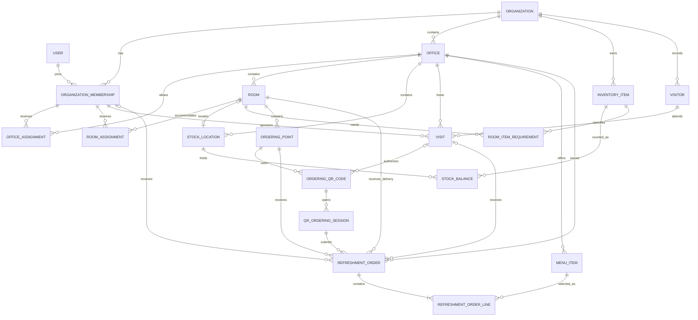

# Office Management — Initial Data and Workflow Model

Status: model draft, updated 14 November 2026. A Next.js application shell and WorkOS authentication wiring are implemented. The business workflows and database records described below remain planned; see the [README](../README.md) for the current implementation boundary.

## Confirmed requirements

- One Next.js repository containing the web application and server logic, with WorkOS authentication.
- One organization is a tenant. Each tenant can manage several office locations, and each office can contain several rooms.
- Rooms need information about employees located there, supplies needed, and furniture or supplies deployed there. Examples include tissue boxes and chairs.
- The initial version tracks employees' assigned rooms. Room headcounts mean assigned employees. Attendance and daily presence tracking are deferred to a future feature.
- Inventory initially tracks quantities, such as six chairs or three tissue boxes. Individually tagged equipment is deferred.
- Refreshment ordering serves senior officials or employees with special access. Ordinary employees can collect snacks from the pantry themselves.
- Managers receive QR codes for their desks and scan them to place refreshment orders. Office helpers receive notifications of new orders.
- Possession of the manager's desk QR code allows ordering for that desk without signing in.
- Visitors waiting for their hosts scan QR codes to order refreshments themselves, without WorkOS accounts. Office helpers serve orders.
- Roles include organization admin, office manager, employee, reception/security, and office helper.
- The project should have a useful working foundation and room for subsequent feature development.

## Working defaults for the draft

The owner has confirmed assigned rooms, quantity-based inventory, QR-only manager ordering, and visitor self-ordering through QR codes. The following implementation choices are proposed defaults:

| Area                 | Proposed default                                                                                                           | Effect on the model                                                                                 |
| -------------------- | -------------------------------------------------------------------------------------------------------------------------- | --------------------------------------------------------------------------------------------------- |
| Manager codes        | Reusable desk codes, with admin revocation and replacement.                                                                | Each code is bound to an eligible recipient and an ordering point.                                  |
| Visitor codes        | Reception issues a code for a checked-in visit, bound to a waiting/delivery point. It stops working at checkout or expiry. | Codes and ordering sessions are scoped to an individual visit.                                      |
| Helper notifications | In-app notifications and an unread indicator in the helper dashboard.                                                      | Persistent notification records support delivery and read state. Other channels can be added later. |

The sections below incorporate the confirmed requirements and these defaults. The first implementation boundary is proposed near the end of this document.

## Organization, identity, and rooms

WorkOS manages sign-in, organization memberships, and organization roles. One WorkOS organization maps to one application tenant. Application records connect those identities to offices, rooms, inventory, and service workflows.

| Entity                 | Purpose                                         | Main fields and relationships                                                                                         |
| ---------------------- | ----------------------------------------------- | --------------------------------------------------------------------------------------------------------------------- |
| User                   | An authenticated person.                        | `id`, unique `workosUserId`, display name, email.                                                                     |
| Organization           | A customer tenant.                              | `id`, unique `workosOrganizationId`, name, status.                                                                    |
| OrganizationMembership | A user's membership in a tenant.                | `id`, `organizationId`, `userId`, unique `workosMembershipId`; membership status and organization role follow WorkOS. |
| Office                 | A physical office location.                     | `id`, `organizationId`, name, code, timezone, address, active status.                                                 |
| OfficeAssignment       | Gives a member access to an office.             | `id`, `organizationId`, `membershipId`, `officeId`.                                                                   |
| Room                   | A room within an office.                        | `id`, `organizationId`, `officeId`, name, code, optional capacity, active status.                                     |
| RoomAssignment         | Records where an employee is normally assigned. | `id`, `organizationId`, `membershipId`, `roomId`, start and end timestamps.                                           |

Office access and an employee's room assignment have different purposes. An employee might be permitted to work at two offices while normally assigned to one room. Each room's assigned headcount is calculated from its active room assignments. The interface should label this count "Assigned employees." Changing a room assignment ends the previous assignment and records the new one, preserving assignment history.

Proposed constraints:

- Office codes are unique within an organization; room codes are unique within an office.
- An office assignment connects a membership and office in the same organization.
- A room assignment requires membership access to that room's office.
- A member cannot have duplicate active assignments to the same room.
- Archived offices and rooms retain their historical relationships and cannot accept new operational activity.

WorkOS membership is the authority for staff access to the application. Local identity and membership records are projections for business relationships; they must not independently grant staff access after the corresponding WorkOS membership has been removed or deactivated. The QR ordering portal authorizes its limited operations through a separate ordering credential, described below.

## Roles and access — proposed permissions

The role names are confirmed; these permissions are a starting proposal. Office access is checked alongside the relevant permission.

| Role               | Proposed responsibilities                                                                                                                                 |
| ------------------ | --------------------------------------------------------------------------------------------------------------------------------------------------------- |
| Organization admin | Manage the tenant, members, office access, locations, ordering eligibility, and desk QR codes. Manage operations across the tenant.                       |
| Office manager     | Manage rooms, inventory, room requirements, deployments, and service operations in assigned offices.                                                      |
| Employee           | Access permitted employee features, act as a visitor's host, and receive a desk QR code when granted ordering eligibility.                                |
| Reception/security | Register visitors, check visitors in and out, issue visit QR codes, and coordinate with hosts in assigned offices.                                        |
| Office helper      | Receive new-order notifications, view and claim refreshment orders, update preparation and delivery progress, and mark orders served in assigned offices. |

Ordering eligibility is a separate capability. Seniority does not grant tenant administration, and fulfilling orders does not automatically make a helper eligible to place personal orders. If someone performs several jobs, the implementation must support the required combination of capabilities.

**Proposed `RefreshmentAccessGrant`:** `id`, `organizationId`, `membershipId`, `officeId`, granting admin membership, grant timestamp, optional revocation timestamp. This represents office-specific eligibility to receive a manager's desk QR code. An active grant identifies the designated recipient and supports issuance of desk codes. Revoking the grant, deactivating the recipient's membership, or removing office access disables orders through its codes and sessions. The person scanning the QR does not sign in; the server checks the code and its grant.

## Inventory and room requirements

Inventory covers consumables such as tissue boxes and reusable items such as chairs. Each catalog item has a base unit and an item type. Quantity tracking is confirmed for the initial version.

| Entity              | Purpose                                                       | Main fields and relationships                                                                                                                                           |
| ------------------- | ------------------------------------------------------------- | ----------------------------------------------------------------------------------------------------------------------------------------------------------------------- |
| InventoryItem       | An item in the tenant's catalog.                              | `id`, `organizationId`, SKU, name, description, category, base unit, type (`consumable` or `reusable`), active status.                                                  |
| StockLocation       | A place where inventory is held.                              | `id`, `organizationId`, `officeId`, name, kind (`storeroom`, `pantry`, or `room`), optional `roomId`, active status.                                                    |
| StockBalance        | Quantity of one item at one location.                         | `id`, `organizationId`, `stockLocationId`, `itemId`, quantity on hand.                                                                                                  |
| StockMovement       | An auditable receipt, transfer, use, disposal, or correction. | `id`, `organizationId`, `itemId`, positive quantity, optional source location, optional destination location, kind, reason, actor membership, timestamp, operation key. |
| RoomItemRequirement | A room's target quantity of a particular item.                | `id`, `organizationId`, `roomId`, `itemId`, target quantity.                                                                                                            |

An office can have stock in its storeroom, pantry, and rooms. Office totals are calculated from those locations. A room's deployed quantity is its stock balance, and its required quantity is its room item requirement.

For the initial quantity model, each room has one room stock location. A shortage is `max(target quantity - deployed quantity, 0)`. Room targets are entered manually; rules that calculate targets from headcount can be added later.

### Example

Room A needs eight chairs and three tissue boxes. It currently holds six chairs and one tissue box. Its shortages are two chairs and two tissue boxes.

Deploying two chairs from the storeroom creates one transfer: storeroom chairs decrease by two and Room A chairs increase by two. The office's total chair count stays the same. Using a tissue box decreases the room's recorded tissue balance; replenishing it transfers another box from storage. Reusable items can be moved back to storage or to another room.

The tissue count reflects recorded deployments and usage. It cannot show actual remaining stock unless someone records consumption or performs a count.

### Stock rules

- SKUs are unique within a tenant; each item/location pair has one balance record; each room/item pair has one target record.
- A room stock location belongs to the same tenant and office as its room. A room has at most one such location in the initial model.
- Quantities use the item's base unit. Whole-unit items such as chairs reject fractional quantities. Packaging conversions can be introduced later.
- Transfers have distinct source and destination locations. Initially both locations belong to the same office; inter-office transfers can be a later workflow.
- Receipts have a destination; consumption or disposal has a source. Corrections use a destination for an increase or a source for a decrease and require a reason.
- All movement endpoints, items, and actors belong to the same tenant, and the actor must have access to the affected office.
- Stock cannot become negative. Concurrent updates must enforce this in the database transaction.
- One transaction creates the movement and updates every affected balance. An operation key prevents a retried request from applying the change twice.
- Movement history is retained. Corrections create additional movements rather than rewriting previous events.
- Archiving catalog items or locations preserves history. Locations with remaining stock require reconciliation before archiving.

Individually tagged equipment is a possible future feature. An `Asset` record could identify each piece and its location or custodian; its relationship to quantity balances would need to prevent double-counting.

## Refreshment ordering

Orders describe office refreshments and service delivery. Each order records its originating QR code and ordering session, intended recipient, delivery destination, and assigned helper. The QR establishes ordering access; it does not establish the identity of the person scanning it.

### Desk QR flow

1. An authorized administrator creates an ordering point for a manager's desk, linked to its office and room, and issues a printable QR code tied to the manager's active access grant.
2. Scanning the code opens a mobile-friendly ordering page for that point. The server resolves its office, room, and desk label.
3. The server validates the QR credential and creates a limited ordering session. No WorkOS sign-in is required for ordering.
4. The manager selects refreshments and submits the order. Its delivery destination is populated from the ordering point.
5. The order appears in the office's helper queue and triggers notifications to the relevant helpers.
6. A helper claims, prepares, and serves the order at the recorded desk.

### Visitor QR flow

1. Reception checks in a visitor, records their host, and selects a waiting/delivery point.
2. Reception issues a QR code tied to that particular visit and delivery point. The code can be printed or displayed for the visitor to scan.
3. The visitor scans, chooses refreshments, and submits without signing in. The order is linked to the visit and sent to the same office helper queue.
4. The helper receives a notification and serves the visitor at the recorded destination.
5. Checkout, code revocation, or the configured expiry disables the visitor code and every ordering session created from it.

The visit-specific issuance and expiry rules are proposed defaults. Both QR ordering flows are part of the refreshment feature's requirements; the overall baseline implementation boundary remains a separate decision.

| Entity                | Purpose                                                                         | Main fields and relationships                                                                                                                                                                                                                                                                       |
| --------------------- | ------------------------------------------------------------------------------- | --------------------------------------------------------------------------------------------------------------------------------------------------------------------------------------------------------------------------------------------------------------------------------------------------- |
| OrderingPoint         | A named delivery destination, such as a manager's desk or visitor waiting area. | `id`, `organizationId`, `officeId`, `roomId`, label, kind (`desk` or `visitor_area`), active status.                                                                                                                                                                                                |
| OrderingQrCode        | An ordering credential bound to a destination and recipient context.            | `id`, `organizationId`, `orderingPointId`, kind (`desk` or `visit`), `refreshmentAccessGrantId` **or** `visitId`, unique token hash, issuing membership, issue timestamp, expiry timestamp, optional revocation timestamp. Expiry is required for visit codes and optional for reusable desk codes. |
| QrOrderingSession     | A limited browser session created by scanning a valid code.                     | `id`, `organizationId`, `orderingQrCodeId`, unique session token hash, creation timestamp, expiry timestamp, optional revocation timestamp. It authorizes ordering and access to orders created by that session.                                                                                    |
| MenuItem              | Something available to order at an office.                                      | `id`, `organizationId`, `officeId`, name, description, category, available status.                                                                                                                                                                                                                  |
| RefreshmentOrder      | One request for refreshments.                                                   | `id`, `organizationId`, `officeId`, `qrOrderingSessionId`, `orderingQrCodeId`, `orderingPointId`, recipient membership **or** `visitId`, `deliveryRoomId`, desk/destination label snapshot, delivery note, status, optional assigned helper membership, operation key, timestamps.                  |
| RefreshmentOrderLine  | An ordered item and quantity.                                                   | `id`, `organizationId`, `orderId`, `menuItemId`, item name snapshot, positive whole quantity, optional preparation note.                                                                                                                                                                            |
| RefreshmentOrderEvent | The history of order progress.                                                  | `id`, `organizationId`, `orderId`, event type, actor kind (`member`, `qr_session`, or `system`), actor membership or QR session where applicable, timestamp, optional reason.                                                                                                                       |
| OrderNotification     | A durable notification for a helper.                                            | `id`, `organizationId`, `orderId`, recipient membership, event type, creation timestamp, optional delivery and read timestamps.                                                                                                                                                                     |

Reception and waiting areas can be represented as rooms so visitor deliveries have a concrete destination.

Proposed workflow: `submitted → preparing → ready → served`. A helper claims the order when preparation starts. A submitted order can be cancelled through the active QR session that created it; authorized service staff can cancel an unserved order with a reason. Reassignment records an event. The server enforces valid transitions and permission checks.

### Ordering and access rules

- Anyone holding a valid desk QR code can place an order for its designated recipient and desk. There is no sign-in step for this flow.
- A visitor QR code permits ordering for one checked-in visit at its bound delivery point. It requires no WorkOS account.
- Each QR code has exactly one recipient context: a desk access grant or a visit, matching its kind. Every order has exactly one recipient: the membership from that grant or the specific visit.
- Tenant, office, recipient, and delivery destination are resolved from the QR's server records. The ordering client cannot choose a different tenant, recipient, or destination.
- QR credentials use unguessable tokens; the database stores their hashes. Sessions use separate expiring credentials. Raw credential values must be excluded from application logs and third-party analytics.
- QR codes resolve to an active ordering point within the same tenant and office. Every ordering request checks session validity, code revocation/expiry, active location, and the active grant or checked-in visit. Revoking or expiring a code also invalidates sessions already created from it. Admins can replace desk codes; authorized reception staff can replace visit codes.
- The order retains its delivery room and desk label snapshot if the ordering point is renamed or moved later. Moving a point to another office requires a new point and QR code.
- Recipient bindings are fixed when a QR code is issued. Assigning a desk to a different recipient requires revoking the old code and issuing a new one.
- A QR session can view the available menu, create orders, and view or cancel its own orders within the permitted workflow. Tenant management, inventory, visitor records, helper queues, and other sessions' order history require the relevant staff access.
- The session, QR code, recipient, helper, menu items, and delivery room must match the order's tenant and office context. The employee recipient and assigned helper must have access to that office.
- Order submission limits apply per QR code across sessions, so rescanning cannot bypass configured order-rate or quantity limits. Exact limits can be set during implementation.
- Helpers see the queue for their assigned offices. Claiming an order must be atomic so two helpers cannot claim the same order simultaneously.
- Only available menu items can be added to a new order. Item name snapshots preserve historical orders after menu edits.
- Repeating a submission with the same operation key returns the existing order and does not create another order or another notification batch.
- A visitor checking out with an unserved order should flag that order for service staff to resolve. The proposed first version requires staff to cancel it explicitly.
- Initial scope assumes office-provided refreshments without payment. Menu availability can be managed manually.

### Helper notifications — proposed delivery

The initial proposal is an in-app notification and unread indicator in the helper dashboard for a new order in an assigned office. Helpers can open the notification to see the order and delivery point. The queue remains the source of current order status; opening a notification for an already claimed order shows its current assignee.

Save the order and its pending notification records together, then dispatch updates after the transaction commits. Failed delivery can be retried. A unique order/event/recipient combination prevents duplicate notification records, and notification reads enforce current tenant and office access. Browser push, email, and SMS are optional delivery channels to decide later; the user has confirmed notifications, not a particular channel.

Automatic inventory deductions require a defined relationship between menu items and stock. A bottled drink may map to one stock item; a cup of coffee may consume several ingredients. That mapping, recipe quantities, and deduction timing are a separate future feature. Pantry self-service consumption can initially be recorded as inventory usage or reconciled through stock counts.

Both desk and visitor flows use the QR session model above. Staff administration and helper fulfillment continue to require WorkOS sign-in and the relevant office permissions.

## Visitor management

| Entity  | Purpose                             | Main fields and relationships                                                                                                                              |
| ------- | ----------------------------------- | ---------------------------------------------------------------------------------------------------------------------------------------------------------- |
| Visitor | A guest record owned by one tenant. | `id`, `organizationId`, name, optional email, optional company.                                                                                            |
| Visit   | One visit by a guest to an office.  | `id`, `organizationId`, `officeId`, `visitorId`, host membership, optional waiting room, purpose, expected arrival, check-in time, check-out time, status. |

Visitors do not need WorkOS accounts. Reception manages visits using staff access, and visitors order using their visit QR codes. Guest records are tenant-specific. The host must belong to the tenant and have access to the visit's office; a waiting room and ordering point must belong to that office.

The proposed lifecycle is `scheduled → checked_in → checked_out`, with cancellation before check-in. Reception can register a walk-in directly as checked in. Every repeat visit gets a new visit record, and visitor refreshment orders link to that particular visit.

## Relationship overview

Access grants, notifications, and history records are omitted here for readability; their roles and constraints are described above.

## Rules shared by every module

- All business records carry an organization ID. Database relationships must enforce matching tenant IDs; application filters alone are insufficient.
- Office-scoped relationships also enforce office consistency. For example, an order cannot reference a delivery room or menu item in another office.
- Staff operations derive the active tenant from the WorkOS session and check role/capability and office access. QR ordering operations derive their tenant, office, recipient, and destination from a validated QR ordering session and its code. Browser-supplied IDs never establish access by themselves.
- Business timestamps are stored consistently; the office timezone controls local display and scheduling.
- WorkOS owns staff authentication credentials. The application stores provider references, business records, and hashes of its limited QR and ordering-session credentials.
- Deactivating a member blocks future actions while preserving references to their historical inventory, visitor, and order activity.

## Proposed first implementation and subsequent work

The initial working foundation could include:

1. WorkOS authentication, tenant membership, role checks, and office access.
2. Office and room management.
3. An inventory catalog, stock receipts and movements, room targets, and room deployments with shortage visibility.
4. Employee room assignments and assigned headcounts.

Subsequent complete features could include refreshment ordering through desk QR codes with helper notifications, visitor registration and check-in/out, visitor refreshments, daily room presence, individually tagged equipment, inventory deductions from refreshments, or inter-office transfers. Each can be useful on its own and have clear acceptance criteria. The owner will choose which workflows belong in the baseline.

Attendance is deferred. If added later, attendance or room presence records will capture actual check-in/out activity separately from an employee's normal room assignment. The exact attendance workflow can be designed when that feature is selected.

Authentication, tenant isolation, and data consistency are part of the foundation. Future work adds functioning capabilities to it. The selected database is PostgreSQL hosted on Neon. The ORM remains to be chosen, and database connectivity and migrations remain planned.

## WorkOS references

- [Users and organizations](https://workos.com/docs/authkit/users-organizations): organizations as customer workspaces and memberships linking users to them.
- [Roles and permissions](https://workos.com/docs/authkit/roles-and-permissions): roles and permissions assigned through organization memberships.
- [Sessions](https://workos.com/docs/authkit/sessions): authenticated organization context and role information in a session.
